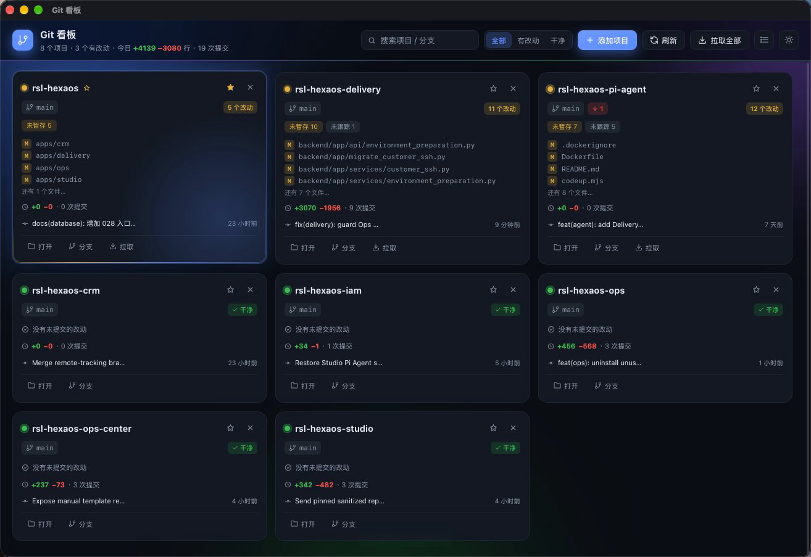
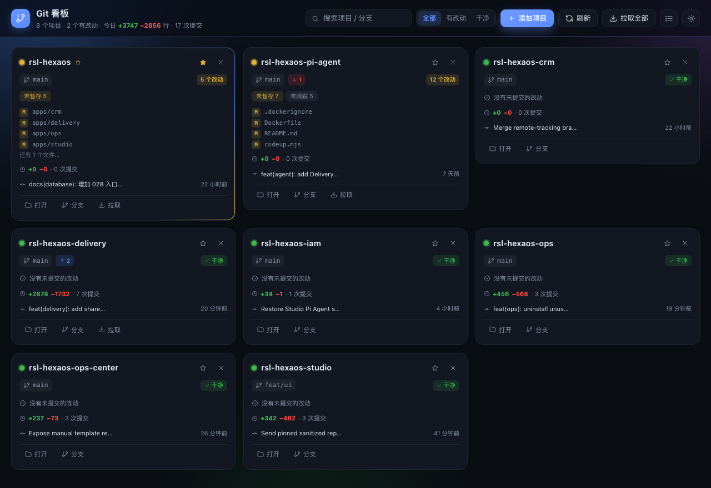
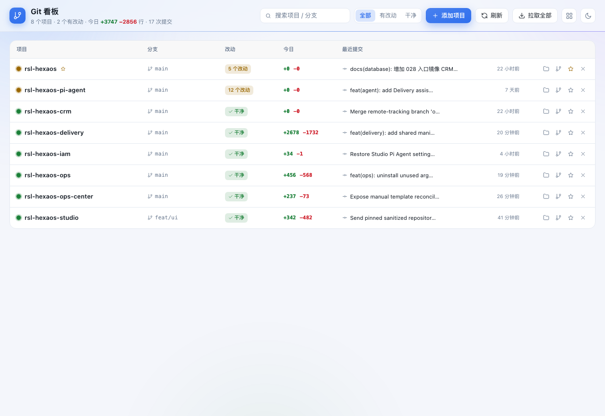

# Git 看板

[](https://github.com/pyfei1994/gitboard/actions/workflows/build.yml)

macOS 上的本地 Git 看板：一个原生窗口，把你机器上的多个仓库集中在一个面板里，
实时显示分支、改动、今日代码量、最近提交，并支持一键拉取、切换分支、置顶。

技术栈：**Tauri 2（Rust）** + **Vue 3 + Vite**，界面走系统 WKWebView，不捆绑浏览器内核。



## 安装

到 [Releases](https://github.com/pyfei1994/gitboard/releases) 下载最新的 `.dmg`，
双击挂载后把 `Git看板.app` 拖进「应用程序」。

> DMG 为 ad-hoc 签名，首次打开若提示「无法验证开发者」，请右键 →「打开」。

## 功能

- 卡片 / 列表两种视图；置顶、移除、打开目录、切换分支
- 分支、领先/落后、已暂存/未暂存/未跟踪、改动文件清单（最多 4 条 + 计数）
- 今日 +/− 行数、提交数、最近提交 + 相对时间
- 添加项目：手输路径或原生选文件夹（支持一次导入多个仓库）
- 拉取：4 路并发 + 「拉取中 x/y」进度，`--ff-only`，拉取期间暂停轮询避免抢锁
- 搜索（项目名 / 分支）、全部 / 有改动 / 干净 筛选
- 深浅主题、⌘R 刷新、Esc 关弹窗、骨架屏加载、Toast 提示
- 光效：极光背景、鼠标跟随高光、置顶卡片流光边框、状态点呼吸、按钮高光（尊重「减弱动态效果」）





## 开发

```bash
cd ui && npm install && npm run build      # 前端 → ui/dist
cd ../src-tauri && cargo build --release   # 后端二进制
cd .. && ./scripts/make-app.sh             # dist/Git看板.app
./scripts/make-dmg.sh                      # dist/Git看板-x.y.dmg
```

只调界面时可以脱离 Tauri，在浏览器里用内置 mock 数据：

```bash
cd ui && npm run dev    # http://localhost:5173/?theme=light&view=list
```

跑测试：

```bash
cd src-tauri && cargo test --release
```

## 结构

```
src-tauri/
  src/main.rs    入口、命令注册、轮询线程
  src/api.rs     Tauri 命令：state / refresh / add_project / pick_projects / pin_project /
                 remove_project / pull / branches / checkout / reveal
  src/git.rs     git 调用（10s 超时、ssh 快速失败）与 status --porcelain=v2 解析
  src/state.rs   状态缓存 + 事件广播（3s 轮询，拉取时暂停）
  src/store.rs   projects.json 读写
ui/
  src/App.vue          顶栏、筛选、网格/列表切换
  src/components/*.vue 卡片、行、弹窗、骨架屏、Toast、图标
  src/lib/api.js       Tauri IPC 封装 + 浏览器 mock
  src/styles.css       深浅主题、光效与全部样式
.github/workflows/     CI：push 构建 + tag 自动发 Release
```

## 数据

配置存在 `~/Library/Application Support/GitBoard/projects.json`（可用 `GITBOARD_DATA_DIR` 覆盖），
内容只有仓库路径和置顶列表；所有 git 操作只读，会改动仓库的只有「拉取」和「切换分支」。

## 版本历史

见 [CHANGELOG.md](CHANGELOG.md)。
